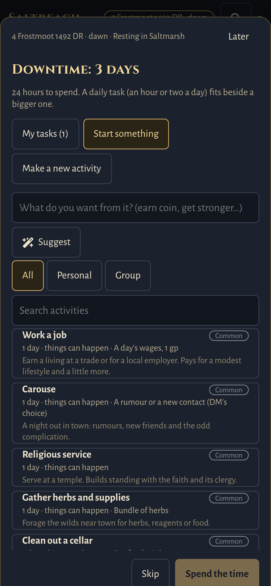
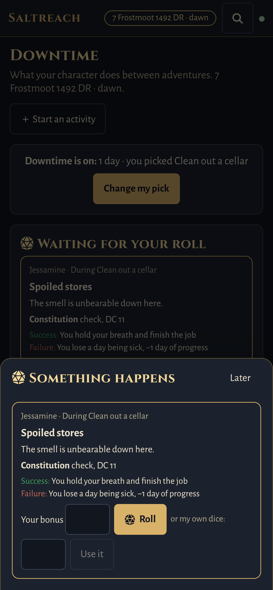
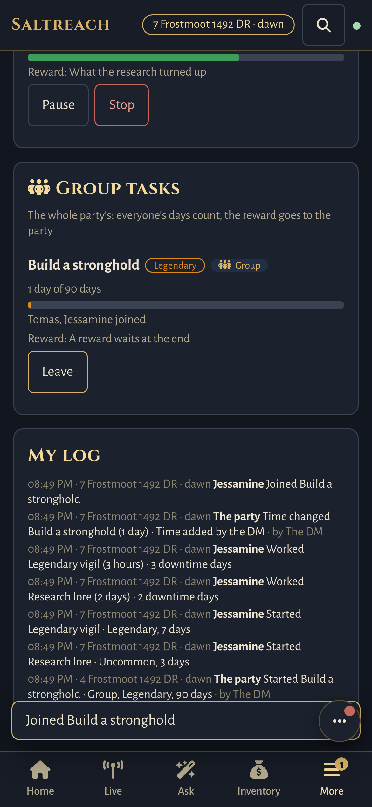

# DownTime

DownTime tracks what characters do between adventures: working a job,
research, crafting, training, a legendary vigil, building a stronghold. It is
a house rule (`mods/downtime.alxmod.json`): the DM turns it on under
**House rules**, and its options set the length of a downtime day, whether
players may make new activities, whether the Downtime button moves the world
clock, and whether rewards are given at once.

## Tiers

Every activity has a tier, and the tier sets how long it takes unless the
activity says otherwise. The DM changes the lengths on the Downtime page
(Activities) or the House rules page (DownTime activities tab).

| Tier | Default length |
| --- | --- |
| Common | 1 day |
| Uncommon | 3 days |
| Rare | 7 days |
| Very rare | 30 days |
| Legendary | 90 days |

A downtime day is 8 hours of work (an option). An activity can take fewer
hours a day: a *daily* task, such as the Legendary vigil (1 hour a day for a
week) or Study under a master (2 hours a day for three months), fits beside
a bigger one in the same day.

## Activities

- **Ready-made**: about 20 come in the rule file (`presets.downtimePremade`),
  so a DM's own copy of the rule can ship its own list. The DM can change or
  hide any of them per world.
- **The DM's own**: added on the Activities tab, by the assistant, or as a
  one-off when assigning.
- **Players'**: made in the popup. With the default option (`approve`) the DM
  sets its tier and reward first, and the days a player spends on it still
  count while it waits. `free` starts it at once; `off` leaves it to the DM.
- **Codex**: with spell crafting on, every recipe a character does not know
  yet is an activity ("Craft Fire Shield"), its tier by the spell's level.
  Finishing it files the usual learn request in the Codex, so the DM's
  approval, items and mana work as always. "Study a spell" is there for
  MANA's study flow, which reads downtime days from the `downtime-day` event.

## Personal and group

Every activity is either **personal** or **group**, and the two are kept apart
everywhere: the popup, the player's Downtime page, the DM's Party tab and the
sheet module each show a Personal list and a Group list.

- A **personal** task is one character's own. They can pause or stop it.
- A **group** task belongs to the whole party (`accountId: "party"`). Anyone
  can put days into it, and all of that work goes into one shared progress
  bar. Starting a group activity the party already has open joins that task
  instead of making a second one. Spending days on a group task also joins
  you to it. Each task lists who joined and how much each person put in.
- Players can **Join** or **Leave** a group task, but they cannot pause or
  stop it. Only the DM can do that.
- A group task's reward goes to the **party pouch and stash**.
- The log shows group work to every player.

The rule ships group activities: Build a stronghold, Run a business together,
Party training regimen, Throw a festival and Plan an expedition. Any activity
becomes a group one with `"group": true`. The DM sets this with a checkbox in
the activity editor. A player sets it with the checkbox on a new activity.
The DM can also assign one to "The whole party".

## Several days at once, and travel days

- **Several days at once:** the DM presses **Downtime** with the number of
  days that passed, for example 5. Each player gets one popup for all five
  days, with 5 × 8 = 40 hours to spread over their tasks. A daily task of an
  hour or two fits beside a bigger one. The world clock moves 5 days in one
  step. Random events roll per day (at most one per task).
- **Travel days:** in D&D 5e, downtime is the time between adventures, so a
  day on the road is not downtime. Many tables still let characters read,
  practise or pray for a little while each day. Tick **Travel** on the
  Downtime button: each day then gives only the world's travel hours (the
  rule's `travelHours` option, `downtimeTravelHours`, 2 by default), and
  every task moves at that pace. Setting it to 0 turns off downtime on the
  road. The API takes `{ travel: true, hours? }`.
- **The day cycle:** each round moves the world clock (unless the DM turns
  that off). Every downtime day spent on a task sends the server event
  `downtime-day`, so features that count study days (MANA's spell study) can
  add them.

## Random events

Something can happen on a downtime day: rats boil out of the cellar you are
cleaning, a fight breaks out where you work, or a dwarf challenges you to a
drinking contest.

- **How often:** each activity can have up to 12 events. Every downtime day
  spent on it has a chance of one, at most one per task per pick. The chance
  is the activity's `eventChance`, or else the world's (the rule's
  `eventChance` option, `downtimeEventChance`). The default is 10%, and 0
  turns events off.
- **What the player sees:** a quick-time card after the pick, showing what
  happens, the check and DC, and both stakes. The player types their bonus
  and the server rolls a d20, or they enter the total from their own dice.
  This is an ability check, so a natural 20 or 1 is not automatic.
- **What an outcome can do:** give or take coin, give an item, add or take
  away days of progress, deal damage, heal, or add levels of exhaustion.
  Exhaustion goes on the sheet as the condition "Exhaustion N". Coin and
  items go to the character who had the event, even on a group task.
- **What the DM sees:** waiting events under the Downtime button. The DM can
  call **Success** or **Failure** without a roll, or **Cancel it**. A new
  pick, or **Take back**, cancels events nobody has rolled yet.
- **Where they're edited:** in the activity editor under **Random events**,
  live and per world.
- **The record:** every event, roll and result is in the log and in table
  chat.

The rule ships events for Clean out a cellar (a new common job), Work a job,
Carouse, Gather herbs, Research lore, Pit fighting, Religious service, Chase
rumours, Craft an item and Run a business together.

## In play

1. When days pass, the DM presses **Downtime** (on the DM's home page, the
   Table, or the Downtime page) and says how many days. The world clock moves
   by that much (an option, undone if the DM takes the round back).
2. Every player gets a popup: their tasks with days on each, **Start
   something** (with **Suggest**, which asks the small helper model for the
   best three for what they want, and All / Personal / Group filters), **Make a new activity** (with **How big is
   it?**, which asks the helper model for the tier and length), or **Skip**.
   The hours have to fit the days. A new pick replaces the old one.
3. The DM sees who picked what and can pick for a player. **Close** ends the
   round (anyone who did not answer is logged as "no pick"); **Take back**
   undoes every pick and puts the clock back.
4. A task that reaches its time is done. Its reward (text, coin, an item, or
   a surprise the player does not see yet) waits for the DM's **Give reward**,
   which puts the coin in the purse, the item in the inventory and a line in
   table chat.

The DM can add or take away time (**＋ day**, **− day**), pause a task, stop
it midway (its work stays in the log), and edit its name, tier, length, hours
a day, reward and a private note at any time.

Every change is in the **log** with the real time, the in-world date, how long
and who did it. Players see their own; the DM sees everyone's. Players can add
a **Downtime** module to their sheet.

## The assistant

The DM's assistant: `downtime` (everyone's tasks and the open round),
`downtime_log`, `downtime_activities`, `downtime_suggest`, `downtime_events`, and with approval
`downtime_round`, `downtime_close_round`, `downtime_assign`, `downtime_time`,
`downtime_work`, `downtime_update`, `downtime_remove`, `downtime_reward`, `downtime_event_decide`. Players also get `downtime_event_roll`.
Players' helpers: `downtime`, `downtime_log`, `downtime_activities`,
`downtime_suggest`, `downtime_start` and `downtime_pick` (their own only; `group: true` starts or
joins a group activity). `downtime_assign` with `group: true` and no player
gives the whole party a group task.

The rank and decide steps use the players' small model (the quick helper's
job when this server has it, else the player job); with no model, a word rule
does the same job and the answer says so (`by: "words"`). Real-model check:
`NODE_USE_ENV_PROXY=1 DOWNTIME_REAL=1 node web/e2e/downtime-real.mjs`.

## API

Under `/api/worlds/:world/downtime`: `GET /`, `GET|POST /activities`,
`PATCH|DELETE /activities/:id`, `GET|POST /tasks`, `PATCH|DELETE /tasks/:id`,
`POST /tasks/:id/time|work|reward|join|leave`, `GET /log`, `GET /rounds`,
`GET /rounds/current`, `POST /rounds`, `POST /rounds/:rid/pick|close|cancel`
(`current` for the open one), `POST /suggest`, `POST /decide`, `GET /events`, `POST /events/:id/roll` (`{ bonus }` or `{ total }`), `POST /events/:id/decide` (`{ result: success | failure | cancel }`). `POST /tasks`
takes `group: true` (the DM may leave out `player` for the whole party);
`GET /tasks?scope=personal|group` filters; `/tasks/:id/work` takes `worker`
on a group task. Live events:
`downtime`, `downtime-round`, `downtime-done`, and the server event
`downtime-day` for features that count downtime days.
