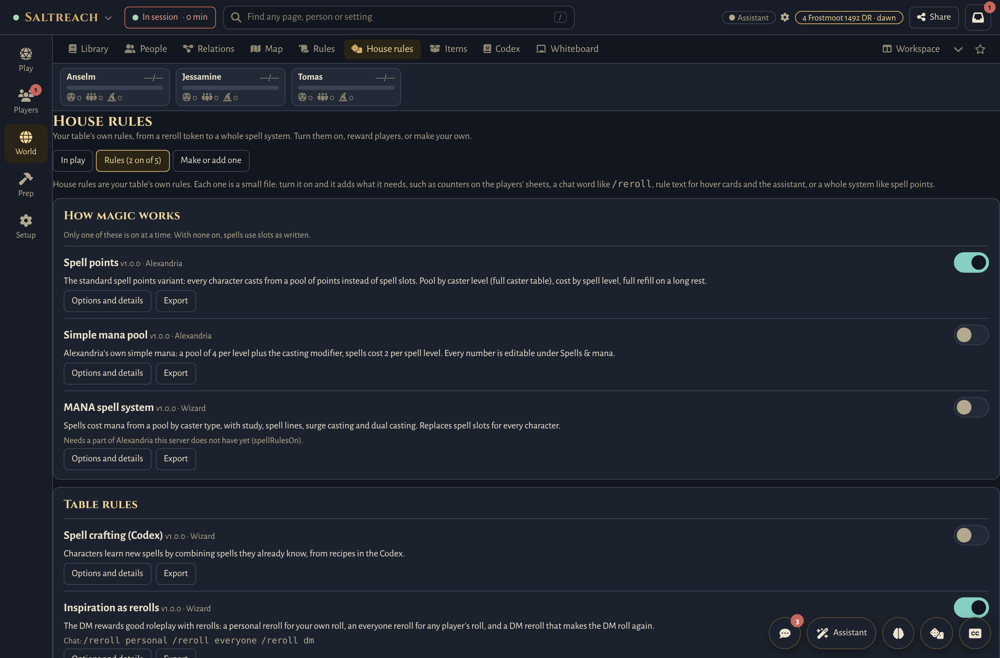
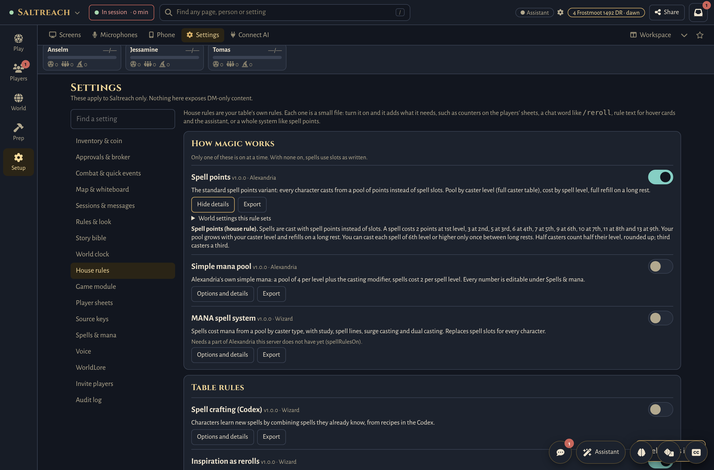
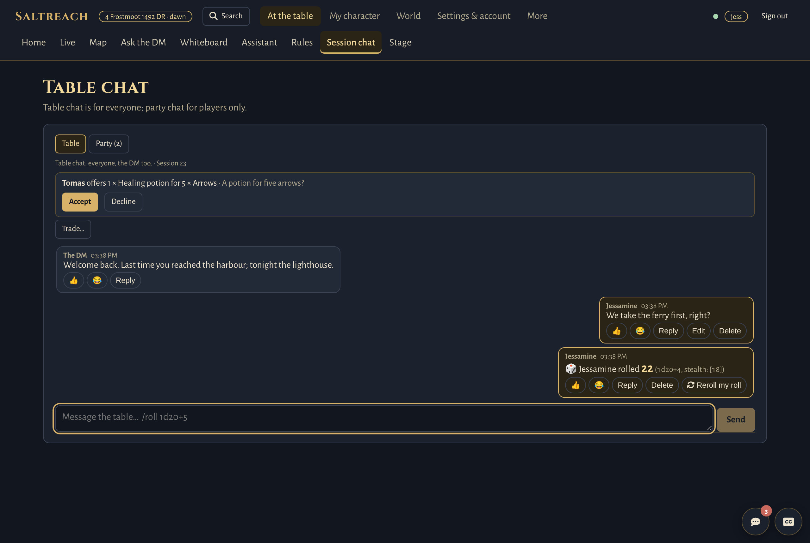
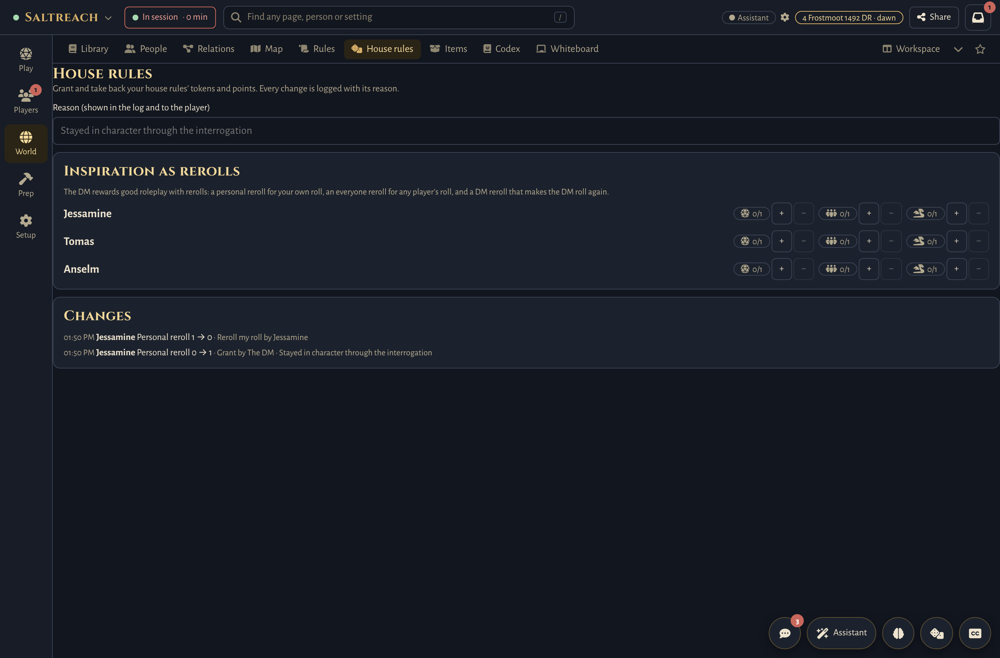

# House rules (mods)

House rules are Alexandria's mods: your table's own rules, from a small one
(inspiration as rerolls, hero points) up to a whole system (spell points, the
MANA spell system, spell crafting). The DM runs them from **World → House
rules**, one page with three tabs:

- **In play**: every player's counters (rerolls, hero points) with Grant and
  Take back, and the log of every change with its reason.
- **Rules**: every rule this world has, the spell systems included, with its
  switch, options and Export.
- **Make or add one**: describe a rule and the assistant writes it, open or
  paste a file someone shared, and how to go further with code.

The same list is also under **World settings → House rules**. Nobody has to
touch Alexandria's code.

There are two kinds, and both show up in the same place:

| Kind | Who makes it | What it is |
| --- | --- | --- |
| **Rule file** | Any DM, by hand or with the assistant | A JSON file (`.alxmod.json`). It is data, never code, so it is safe to take one from a stranger. |
| **System** | Developers | A feature (`librarian/src/features/<id>`, see [FEATURES.md](FEATURES.md)) that claims rule files in its `houseRules`. Usually a rule whose `presets` switch the feature's settings on, so the DM turns the whole system on with one switch. |

Every rule that comes with Alexandria is a file in the repo's
[`mods/`](../mods/README.md) folder. The server reads each `*.alxmod.json`
there when it starts. Whoever runs a server can drop more files in (or set
`ALX_MODS_DIR` to a folder of their own) and restart, and the rules show up in
every world.





## What comes with Alexandria

| Rule | Group | What it does |
| --- | --- | --- |
| Inspiration as rerolls | | The DM rewards roleplay with a **personal** reroll (your own roll), an **everyone** reroll (any player's roll) or a **DM** reroll (the DM rolls again). Cap per type (default 1), keep-the-better option. It switches on the player sheet's Re-rolls module and the DM status bar chips (`sheetRerolls`, `sheetRerollCap`), which read and write the same counters (the sheet calls "everyone" "party"). |
| Spell points | magic | The standard spell points variant: a pool by caster level, costs 2/3/5/6/7/9/10/11/13 by spell level, highest spell level by character level, full refill on a long rest. |
| Simple mana pool | magic | Alexandria's own mana numbers (4 per level plus the casting modifier). |
| MANA spell system | magic | Wizard's MANA rules. Needs the MANA engine (`spellRulesOn`); until it is on this server the rule shows but cannot be turned on. |
| Spell crafting (Codex) | | Learn new spells by combining known ones, with the DM's approval or automatically. |

Rules in the same **group** are exclusive: turning on spell points turns the
simple mana pool or MANA off first. With no magic rule on, spells use slots.

## How a rule works in play

- **Counters** (reroll tokens, hero points) live on the server per character.
  Every change is logged with who, when, the amount and the reason. The DM sees
  everyone's on the **House rules** page (Grant and Take back); a player sees
  their own on their home page and the House rules page.
- **Actions** change a counter. Each one says who may run it: `dm`, `owner`
  (only that character's player), `player` (any player, on anyone) or `any`
  (the DM or the owner). The server checks it.
- **Rerolls** happen on the server, so nobody can fudge them. A player presses
  the Reroll button under a roll in session chat, or types `/reroll personal`
  (as a reply to pick a roll, otherwise the latest one that fits). The new roll
  is posted under the old one. A token spent on a roll made with real dice is
  "Used at the table".
- **Triggers** run on a long or short rest on the world clock, and when a
  session starts or ends.
- **Rule text** joins the world's glossary while the rule is on: hover cards,
  the Rules page, rules lookups, the broker and the assistant all know it.
- **Presets** set world settings while the rule is on. The DM confirms the
  change; turning the rule off puts the old values back.





## The file

A file holds one rule, or a **package** of several (see Sharing).

```json
{
  "kit": 1,
  "id": "hero-points",
  "name": "Hero points",
  "version": "1.0.0",
  "author": "Wizard",
  "summary": "1 per session, spend one to add 1d6 to a roll.",
  "options": {
    "max": { "type": "int", "default": 3, "min": 1, "max": 10, "label": "Most hero points" }
  },
  "resources": [
    { "id": "hero", "label": "Hero point", "icon": "fa-star", "max": "$max", "start": 1 }
  ],
  "actions": [
    { "id": "give", "label": "Give", "by": "dm", "resource": "hero", "add": 1, "askReason": true },
    { "id": "spend", "label": "Spend", "by": "owner", "resource": "hero", "add": -1,
      "effect": { "chat": "{name} spends a hero point: +1d6 ({note})" } }
  ],
  "triggers": [{ "on": "sessionStart", "resource": "hero", "add": 1 }],
  "commands": [{ "word": "hero", "action": "spend" }],
  "sheet": { "title": "Hero points", "resources": ["hero"] },
  "dmBand": { "chips": ["hero"], "actions": ["give"] },
  "rules": [{ "term": "Hero points", "text": "Spend one to add 1d6 to any roll." }]
}
```

| Part | Holds |
| --- | --- |
| `kit` | The format version: `1`. |
| `id`, `name` | Required. The id is lowercase letters, digits and dashes. |
| `version`, `author`, `summary` | Shown in World settings. |
| `group` | Rules of one group are exclusive (`magic`). |
| `options` | What the DM tunes: `{ type: boolean \| int \| enum \| string, default, label, help? }` (`min`/`max` for int, `values` for enum). Anywhere a number or yes/no goes, `"$name"` reads an option. |
| `resources` | Counters: `{ id, label, icon? (Font Awesome, e.g. fa-star), max? (null = no cap), start?, private? }`. |
| `actions` | `{ id, label, by, resource (an id, or "*" when the caller says which), add, askReason?, effect? }`. |
| `effect` | `reroll: { whose: own \| anyPlayer \| dm, keepBetter }`, `chat: "text"` (posted to table chat; `{name}` and `{note}` are filled in), `dmnote: "text"` (a note only the DM sees). |
| `triggers` | `{ on: longRest \| shortRest \| sessionStart \| sessionEnd, resource (or "*"), set (a number or "max") and/or add }`. |
| `commands` | Chat words: `{ word, args?, action }`; `"use-$1"` with `args: ["a","b"]` makes `/word a` run `use-a`. `roll`, `me` and `help` are taken. |
| `sheet`, `dmBand`, `table` | Where the counters show: the player's card and sheet, the DM's status bar chips and actions, a Table block. |
| `rules` | `{ term, text }`: the rule in plain words (Markdown). |
| `presets` | World settings to set while on, e.g. `{ "spellMana": true }`. A setting this server does not have yet is skipped. |
| `requires` | `{ settings: [...] }`: settings the rule cannot work without. |

Limits: 64 KB per file, 12 resources, 24 actions, 12 triggers, 8 commands, 16
options. A world holds up to 50 of its own rules.

## Making one with the assistant

Under **House rules → Make or add one**, describe the rule (or pick a starter
idea) and press **Ask the assistant**. Or describe the rule in the chat in your own words ("my players get hero points: one per
session, spend one to add 1d6 to a roll"). The assistant writes the file,
checks it with `house_rule_check` until it has no errors, shows it to you, and
saves it with `house_rule_save` once you agree. It starts off; turn it on
under Rules. You can also paste a file under **Add a house rule** and press
**Check**.


Assistant tools: `house_rules` (what is on and how it works),
`house_rule_counters`, `house_rule_grant` (DM: give a reroll for good
roleplay, with the reason), `house_rule_spend` (a player spends their own),
`house_rule_check` and `house_rule_save` (DM: draft and save rules).

## Sharing

**Export** gives a package: one `.alxmod.json` file with the rule (or, with
**Export the rules that are on**, every rule that is on), who made it, when,
and for which Alexandria:

```json
{
  "type": "alexandria-house-rules",
  "kit": 1,
  "name": "Saltreach table rules",
  "author": "Wizard",
  "summary": "Inspiration as rerolls, Hero points",
  "exported": "2026-11-26T15:00:00.000Z",
  "alexandria": "0.1.0-alpha.1",
  "mods": [ { "kit": 1, "id": "inspiration-rerolls", "...": "..." } ]
}
```

The other DM opens or pastes it under **Make or add one → Add a house rule**.
Check lists every rule in it; Save adds them all, each starting off. A package
holds up to 25 rules (512 KB). A bare rule file works the same way. Saving a
rule whose id the world already has replaces it and keeps the counters of
resources that still exist. The ids of rules that come with Alexandria are
taken, and a package with one of them is refused whole.

To make a rule built in for everyone on a server, put the file (rule or
package) in `mods/` instead.

## API

Under `/api/worlds/:world/mods`: `GET /` (the DM gets every rule, a player
only those on), `GET /rules`, `GET /counters`, `GET /log`, `POST /check`,
`POST /import` (a rule or a package), `GET /export?ids=a,b` (a package of
those rules, or of every rule that is on), `GET /:id/export` (a package of one), `PUT /:id/enabled { on }`,
`PUT /:id/options { options }`, `DELETE /:id` (DM only, except the reads), and
`POST /:id/act { action, player?, resource?, note?, rollId?, channel?, atTable? }`.
Live events: `mods` (rules changed), `mods-counts` (to the DM and the
player whose counters changed), `mods-note` (DM only).

## For developers: shipping a system as a house rule

A feature adds `houseRules: ['spell-points', ...]` to its `Feature`: the ids
of its rule files in `mods/` (an inline rule object works too). The rule
usually holds only `presets` for the feature's own settings (and `options`
the presets read), plus `requires` when it needs settings that may be
missing. The spells feature ships spell points, the simple mana pool and spell
crafting this way. Two hooks let a feature work with house rules without
editing them:

- `addCommandResolver` (`features/sessionchat/hooks.ts`) answers a chat word;
  `postChat` posts a message as someone.
- `addTermSource` (`features/modules/store.ts`) adds glossary terms.

On the web, a feature may add `chatActions` (buttons under a chat message)
and `houseRuleTabs: [{ mod, title, component }]`: its own tab on the DM's
House rules page, shown while that rule is on (DownTime's activities, say).
