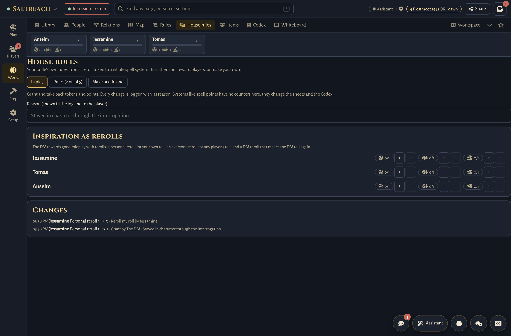
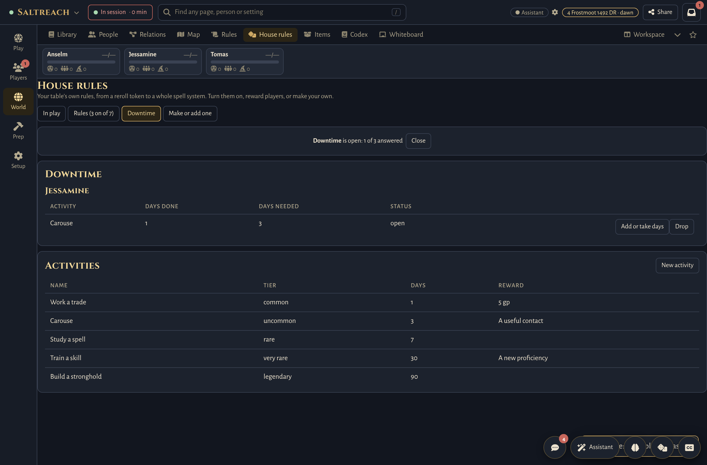
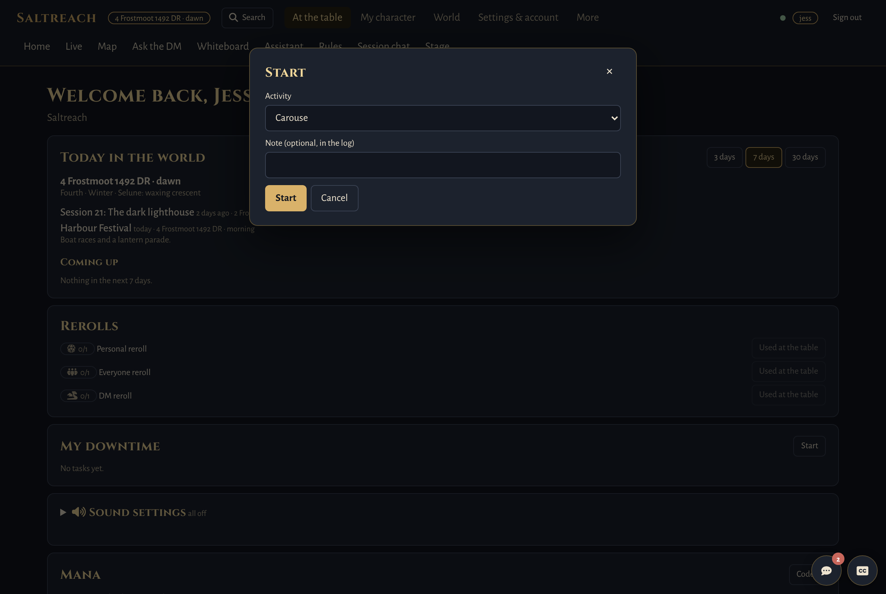
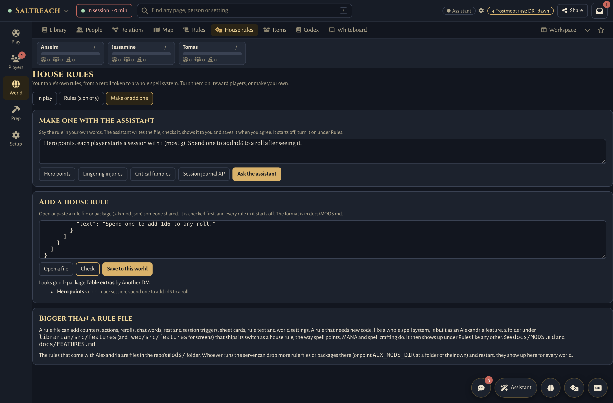

# House rules (mods)

House rules are Alexandria's mods: your table's own rules, from a small one
(inspiration as rerolls, hero points) up to a whole system (spell points, the
MANA spell system, spell crafting). The GM runs them from **World → House
rules**, one page with three tabs:

- **In play**: every player's counters (rerolls, hero points) with Grant and
  Take back, and the log of every change with its reason.
- **Rules**: every rule this world has, the spell systems included, with its
  switch, options and Export.
- **Make or add one**: describe a rule and the assistant writes it, open or
  paste a file someone shared, and how to go further with code.

The same list is also under **World settings → House rules**. Nobody has to
touch Alexandria's code.

There are two kinds, and both show up in the same place:

| Kind | Who makes it | What it is |
| --- | --- | --- |
| **Rule file** | Any GM, by hand or with the assistant | A JSON file (`.alxmod.json`). It is data, never code, so it is safe to take one from a stranger. |
| **System** | Developers | A feature (`librarian/src/features/<id>`, see [FEATURES.md](FEATURES.md)) that claims rule files in its `houseRules`. Usually a rule whose `presets` switch the feature's settings on, so the GM turns the whole system on with one switch. |

Every rule that comes with Alexandria is a file in the repo's
[`mods/`](../mods/README.md) folder. The server reads each `*.alxmod.json`
there when it starts. Whoever runs a server can drop more files in (or set
`ALX_MODS_DIR` to a folder of their own) and restart, and the rules show up in
every world.


## What comes with Alexandria

| Rule | Group | What it does |
| --- | --- | --- |
| Inspiration as rerolls | | The GM rewards roleplay with a **personal** reroll (your own roll), an **everyone** reroll (any player's roll) or a **GM** reroll (the GM rolls again). Cap per type (default 1), keep-the-better option. It switches on the player sheet's Re-rolls module and the GM status bar chips (`sheetRerolls`, `sheetRerollCap`), which read and write the same counters (the sheet calls "everyone" "party"). |
| Spell points | magic | The standard spell points variant: a pool by caster level, costs 2/3/5/6/7/9/10/11/13 by spell level, highest spell level by character level, full refill on a long rest. |
| Simple mana pool | magic | Alexandria's own mana numbers (4 per level plus the casting modifier). |
| MANA spell system | magic | Wizard's MANA rules. Needs the MANA engine (`spellRulesOn`); until it is on this server the rule shows but cannot be turned on. |
| Spell crafting (Codex) | | Learn new spells by combining known ones, with the GM's approval or automatically. |
| DownTime | | Downtime activities from common to legendary: the GM presses Downtime when days pass and each player picks what to work on. See [DOWNTIME.md](DOWNTIME.md). |

Table rules, the house rules 5e tables use most (from house-rule surveys and
threads on EN World, TheGamer, ScreenRant and GamersDecide). Each one is off
until the GM turns it on, and each one tells the assistant and the player
helper how it works:

| Rule | Kind | What it does |
| --- | --- | --- |
| Potions as a bonus action | rule text | Drinking a potion yourself is a bonus action; giving one is an action. |
| Flanking: +2, not advantage | rule text, option | Allies on opposite sides each get a bonus to hit (option, default +2). |
| Criticals on ability checks | rule text | A natural 20 is the best result the task allows; a natural 1 adds a complication. |
| Hidden death saves | rule text | The GM rolls death saves in secret; Medicine DC 10 shows stable or not. |
| Hit points: roll, keep the better | rule text | On level up, the Hit Die roll or the average, whichever is higher. |
| Gritty realism rests | rule text | Short rest 8 hours, long rest 7 days. The assistant advances the clock to match. |
| Party inspiration pool | data system | One shared pool (up to 10). The GM adds points; any player draws one for advantage. Turns inspiration rerolls off. |
| Lingering injuries | data system | The GM gives an injury on a crit or a drop to 0 HP. Each long rest counts toward healing; 0 days means magic only. |
| Brutal critical hits | rule text | A crit deals the dice's maximum plus one normal roll. |
| Critical fumbles | rule text | A natural 1 on an attack gives a mild mishap: drop the weapon, an opening, or a stumble. |
| A free feat at 1st level | rule text | Every character starts with one extra feat. |
| Full hit dice on a long rest | rule text | A long rest gives back all spent hit dice. |
| Massive damage | rule text | Half your HP maximum in one hit: DC 15 Constitution save or a d10 result. |
| Morale | rule text | Enemies may flee or surrender (DC 10 Wisdom save) when a fight turns against them. |
| Cleaving through creatures | rule text | Leftover melee damage carries to another creature in reach. |
| Side initiative | rule text | Each side rolls one initiative and acts together. |
| Slot inventory | rule text | Carry items equal to your Strength score; bulky ones take 2 slots. |
| Bloodied | rule text | The GM says when a creature is at half HP or less. |
| Potions heal fully as an action | rule text | Drinking a healing potion with your action heals its maximum. |
| Climbing onto big creatures | rule text | Climb a creature two sizes larger and attack it with advantage. |
| Luck points | counters | Reroll a d20 after seeing it; refills each session. Chat word /luck. |
| Stress | counters | Horror adds stress; at the limit the character breaks for the session. A long rest takes 2 off. |
| Honor | counters | An Honor score (0 to 20) the GM raises or lowers. |
| Simple exhaustion | counters | Each level is -2 to d20 rolls and -5 feet of speed; a long rest takes one off. |
| Crafting projects | data system | Players start projects; each long rest adds a day of work until the item is done. |
| Faction renown | data system | The party's renown and rank with each faction. |
| Training | data system | Learn a language or a tool over days of training. |
| Hirelings | data system | The party's hirelings with their job, wage and loyalty. |

Rules in the same **group** are exclusive: turning on spell points turns the
simple mana pool or MANA off first. With no magic rule on, spells use slots.

## How a rule works in play

- **Counters** (reroll tokens, hero points) live on the server per character.
  Every change is logged with who, when, the amount and the reason. The GM sees
  everyone's on the **House rules** page (Grant and Take back); a player sees
  their own on their home page and the House rules page.
- **Actions** change a counter. Each one says who may run it: `gm`, `owner`
  (only that character's player), `player` (any player, on anyone) or `any`
  (the GM or the owner). The server checks it.
- **Rerolls** happen on the server, so nobody can fudge them. A player presses
  the Reroll button under a roll in session chat, or types `/reroll personal`
  (as a reply to pick a roll, otherwise the latest one that fits). The new roll
  is posted under the old one. A token spent on a roll made with real dice is
  "Used at the table".
- **Triggers** run on a long or short rest on the world clock, and when a
  session starts or ends.
- **Rule text** joins the world's glossary while the rule is on: hover cards,
  the Rules page, rules lookups, the broker and the assistant all know it.
- **Presets** set world settings while the rule is on. The GM confirms the
  change; turning the rule off puts the old values back.




## The file

A file holds one rule, or a **package** of several (see Sharing).

```json
{
  "kit": 2,
  "id": "hero-points",
  "name": "Hero points",
  "version": "1.0.0",
  "author": "Wizard",
  "summary": "1 per session, spend one to add 1d6 to a roll.",
  "options": {
    "max": { "type": "int", "default": 3, "min": 1, "max": 10, "label": "Most hero points" }
  },
  "resources": [
    { "id": "hero", "label": "Hero point", "icon": "fa-star", "max": "$max", "start": 1 }
  ],
  "actions": [
    { "id": "give", "label": "Give", "by": "gm", "resource": "hero", "add": 1, "askReason": true },
    { "id": "spend", "label": "Spend", "by": "owner", "resource": "hero", "add": -1,
      "effect": { "chat": "{name} spends a hero point: +1d6 ({note})" } }
  ],
  "triggers": [{ "on": "sessionStart", "resource": "hero", "add": 1 }],
  "commands": [{ "word": "hero", "action": "spend" }],
  "sheet": { "title": "Hero points", "resources": ["hero"] },
  "gmBand": { "chips": ["hero"], "actions": ["give"] },
  "rules": [{ "term": "Hero points", "text": "Spend one to add 1d6 to any roll." }]
}
```

| Part | Holds |
| --- | --- |
| `kit` | The format version: `2` (files with `1` still work; the kit 2 fields are below). |
| `id`, `name` | Required. The id is lowercase letters, digits and dashes. |
| `version`, `author`, `summary` | Shown in World settings. |
| `group` | Rules of one group are exclusive (`magic`). |
| `options` | What the GM tunes: `{ type: boolean \| int \| enum \| string, default, label, help? }` (`min`/`max` for int, `values` for enum). Anywhere a number or yes/no goes, `"$name"` reads an option. |
| `resources` | Counters: `{ id, label, icon? (Font Awesome, e.g. fa-star), max? (null = no cap), start?, private? }`. |
| `actions` | `{ id, label, by, resource (an id, or "*" when the caller says which), add, askReason?, effect? }`. |
| `effect` | `reroll: { whose: own \| anyPlayer \| gm, keepBetter }`, `chat: "text"` (posted to table chat; `{name}` and `{note}` are filled in), `gmnote: "text"` (a note only the GM sees). |
| `triggers` | `{ on: longRest \| shortRest \| sessionStart \| sessionEnd, resource (or "*"), set (a number or "max") and/or add }`. |
| `commands` | Chat words: `{ word, args?, action }`; `"use-$1"` with `args: ["a","b"]` makes `/word a` run `use-a`. `roll`, `me` and `help` are taken. |
| `sheet`, `gmBand`, `table` | Where the counters show: the player's card and sheet, the GM's status bar chips and actions, a Table block. |
| `rules` | `{ term, text }`: the rule in plain words (Markdown). |
| `presets` | World settings to set while on, e.g. `{ "spellMana": true }`. A setting this server does not have yet is skipped. |
| `requires` | `{ settings: [...], mods: { "rule-id": "^1" } }`: settings the rule cannot work without, and other house rules it builds on with a version range. Turning it on turns those on first; turning one of them off asks to turn this one off too. |
| `alexandria` | Kit 2: the Alexandria versions it is built for, a range like `">=0.2"`, `"^0.1"` or `">=1.2 <2"`. Outside it the rule shows why and cannot be turned on. |
| `targets` | Kit 2: `{ builtFor: [...], worksWith: [...] }`. The parts it is made for (`sheet`, `codex`, `chat`, `table`, `combat`, `inventory`, `clock`, `map`, `shop`, `encounters`, `stage`, `assistant`, `library`, or a game module id such as `dnd-2024`) and the ones it only adds to. Shown as badges; a missing `builtFor` part keeps it off. |
| `conflicts` | Kit 2: ids of rules that cannot be on at the same time. Turning this one on turns them off, like a `group`. |
| `permissions` | Kit 2: what it touches beyond what its parts already say (`records`, `net`, ...). The GM sees the full list under Options and details. |
| `assistant` | Kit 2: how the GM's assistant and the player helper work with the rule (see below). |
| `api` | Kit 2: the mod API version a code mod was written against (data rules leave it out). |

Limits: 128 KB per file, 12 resources, 24 actions, 12 triggers, 8 commands, 16
options. A world holds up to 50 of its own rules.

## Data systems: lists, progress and a popup for each player

Counters cover points and tokens. A rule that has to keep lists (downtime
activities, crafting projects, reputation with factions) uses the data-system
parts, with no code. [`mods/examples/downtime-lite.alxmod.json`](../mods/examples/downtime-lite.alxmod.json)
is a whole downtime system in about 60 lines.

| Part | Holds |
| --- | --- |
| `records` | Kinds of record: `{ "<kind>": { label, plural?, owned?, title?, fields, seed? } }`. `owned`: each record belongs to one player. Fields are `"text"`, `"int"`, `"bool"`, `"enum:a\|b"`, `"ref:<kind>"` (add `?` for optional), or `{ type, label, default, min, max, values, ref }`. `seed`: ready-made records made the first time the rule goes on (not for owned kinds). |
| `recordActions` | `{ id, label, by, record, do: create \| set \| add \| remove }` with `ask` (fields the caller fills in), `set` (fixed values), `copy: { via, fields }` (copy from the record a ref points at), `field` + `amount` (a number or `"ask"`) for add, `where` (only records like this) and `effect` (`chat`, `gmnote`). |
| `timers` | `{ id, record, on, where, field, add, goal, done: { set, chat } }`. `on` is a rest, a session start or end, or `prompt:<id>`. `goal` is a number, an option or another field of the record. `done` runs once when the field reaches it. |
| `prompts` | `{ id, button, title, text, choices: [{ label, action } \| { label, skip: true }] }`. The GM presses the button and every player gets a popup. A choice runs its record action for them, and `prompt:<id>` timers move only the records of players who did not skip. |
| `views` | `{ id, title, record, place: gm \| sheet \| player, columns, where?, actions?, groupByPlayer? }`. `gm` is a tab on the GM's House rules page, `sheet` the player's sheet and home card, `player` the player's House rules page. |

Chat text in a data system may use `{name}` (the record's player; on a shared record, whoever ran the action), `{note}` (the reason given),
`{field}`, `{title}`, `{kind.field}` for the record's own field (so a field
called `name` is `{project.name}`) and `{ref.field}` (the record a ref points
at). The check names any placeholder that does not exist.

Limits: 8 kinds, 16 fields each, 300 seed records, 24 record actions, 8
timers, 4 prompts of up to 6 choices, 8 views. Every change is logged with
who did it.

What goes wrong: a record action whose `by` is `owner` on a shared kind can
only be run by the GM (nobody owns it). Use `any` or `player`. Removing a rule
deletes its records and log.




## How the assistant and the player helper work with a rule

A rule that is on is known to the GM's assistant and to each player's table
helper without any code. When a message is about the rule (its name, its
counters, its record kinds, its prompt button, its chat words, or the words in
its `assistant` part), they get a short note with:

- the rule's summary and the guidance written for them. The GM's text is
  only for the GM, and the player's text only for players.
- the exact calls they can make with it, such as
  `house_rule_my_record {"mod":"downtime-lite","action":"start","values":{"activity":...}}`.
- what they may see now. The GM sees every record and counter. A player sees
  shared lists (the activities) and their own records and counters, never
  another player's.

They are also offered the house rule tools, and any feature tools the rule
names. That is how a Codex rule hooks the assistant into the Codex:

```json
"assistant": {
  "words": ["craft a spell", "combine spells", "spell recipe", "codex"],
  "tools": ["my_spell_codex", "list_spell_recipes", "read_spell", "draft_spell_recipe"],
  "player": "To help a player craft: read their codex with my_spell_codex, then list_spell_recipes; say which recipes they can make now and what each still needs.",
  "gm": "draft_spell_recipe proposes a new recipe for the GM to approve. When a player asks to craft, check they know every spell the recipe needs."
}
```

| Field | Holds |
| --- | --- |
| `words` | Up to 24 extra words or phrases (3 to 40 letters) that bring the rule up. |
| `gm` | Guidance only the GM's assistant sees (up to 1,200 letters). |
| `player` | Guidance only the player helper sees. Write it as advice to the helper. |
| `tools` | Tools from features to offer with the rule (Codex: `my_spell_codex`, `read_spell`, `list_spell_recipes`, `draft_spell_recipe`, `list_spells`). A tool the server does not have is left out. |

Spell crafting, spell points and the simple mana pool ship with an
`assistant` part, and so does `mods/examples/downtime-lite.alxmod.json`. In a
test with the real player model, a player asked their helper "what should I
do for downtime? I want gold or contacts". The helper suggested Work a trade
and Carouse from the rule's list. Told "a day passes", the GM's assistant
proposed opening the Downtime day (`web/e2e/houserule-helpers-real.mjs`).

What goes wrong: a word that is too common (`day`, `rest`) brings the rule
into messages that are not about it. Use phrases. At most three rules are
added to one message.

## Making one with the assistant (the Mod studio)

Under **House rules → Make or add one**, describe the rule (or pick a starter
idea: hero points, downtime, crafting projects, spell points...) and press
**Ask the assistant**. Or say it in the chat in your own words ("my players
get hero points: one per session, spend one to add 1d6 to a roll").

The assistant:

1. reads `house_rule_guide`, which says which kind of rule fits (counters, a
   data system, or presets for a system Alexandria already has) and gives
   every field,
2. opens a close example with `house_rule_file` (`hero-points`,
   `downtime-lite`, or any rule that comes with Alexandria),
3. writes the file and runs `house_rule_check` until it has no errors,
4. tells you what the rule does from the check's **preview**, in plain words,
5. saves it with `house_rule_save { draft }` once you agree. The draft id
   from the check saves exactly the file that was checked, so nothing is
   retyped. A save of a file that does not check is never shown to you as a
   card.

It starts off; turn it on under Rules. To change a rule, ask for the change:
the assistant reads it with `house_rule_file`, keeps its id and raises its
version. A rule that comes with Alexandria is copied under a new id instead.
You can also paste a file under **Add a house rule** and press **Check**;
**What it does** shows the same preview.



Assistant tools: `house_rules` (what is on and how it works),
`house_rule_counters`, `house_rule_grant` (GM: give a reroll for good
roleplay, with the reason), `house_rule_spend` (a player spends their own),
`house_rule_records`, `house_rule_record_act` (GM) and `house_rule_my_record`
(a player) for data systems, `house_rule_prompt` (GM: open a downtime day),
and `house_rule_guide`, `house_rule_file`, `house_rule_check`,
`house_rule_save` (GM: make and change rules).

Tested against the test chat model (`web/e2e/modstudio-real.mjs`, a few
tenths of a cent a run): from one sentence each it made luck points
(counters), crafting projects (a data system with a long-rest timer and two
views), a full Downtime rule with tiers and the daily popup, and a copy of
inspiration rerolls with a higher cap. Each one saved and turned on.

## Sharing

**Export** gives a package: one `.alxmod.json` file with the rule (or, with
**Export the rules that are on**, every rule that is on), who made it, when,
and for which Alexandria:

```json
{
  "type": "alexandria-house-rules",
  "kit": 2,
  "name": "Saltreach table rules",
  "author": "Wizard",
  "summary": "Inspiration as rerolls, Hero points",
  "exported": "2026-11-26T15:00:00.000Z",
  "alexandria": "0.1.0-alpha.1",
  "mods": [ { "kit": 2, "id": "inspiration-rerolls", "...": "..." } ]
}
```

The other GM opens or pastes it under **Make or add one → Add a house rule**.
Check lists every rule in it; Save adds them all, each starting off. A package
holds up to 25 rules (512 KB). A bare rule file works the same way. Saving a
rule whose id the world already has replaces it and keeps the counters of
resources that still exist. The ids of rules that come with Alexandria are
taken, and a package with one of them is refused whole.

To make a rule built in for everyone on a server, put the file (rule or
package) in `mods/` instead.

## API

Under `/api/worlds/:world/mods`: `GET /` (the GM gets every rule, a player
only those on), `GET /rules`, `GET /counters`, `GET /log`, `POST /check`,
`POST /import` (a rule or a package), `GET /export?ids=a,b` (a package of
those rules, or of every rule that is on), `GET /:id/export` (a package of one), `PUT /:id/enabled { on }`,
`PUT /:id/options { options }`, `DELETE /:id` (GM only, except the reads), and
`POST /:id/act { action, player?, resource?, note?, rollId?, channel?, atTable? }`.
Mod studio: `GET /guide?part=start|counters|data|presets|manifest` and
`GET /:id/file` (a rule or an example as its file), both GM only; `POST /check`
also returns `preview` (lines) and `draft`, and `POST /import { draft }` saves
a checked draft (an hour). Data systems: `GET /:id/records?kind&player`,
`GET /:id/records-log`, `POST /:id/records/:action { recordId?, player?, values?, amount?, note? }`,
`POST /:id/prompts/:prompt` (GM), `GET /prompts/open`,
`POST /:id/prompts/round/:round/answer { choice, values? }` and
`POST /:id/prompts/round/:round/close` (GM).
Live events: `mods` (rules changed), `mods-counts` (to the GM and the
player whose counters changed), `mods-note` (GM only), `mods-records` and `mods-prompt`.

## For developers: shipping a system as a house rule

A feature adds `houseRules: ['spell-points', ...]` to its `Feature`: the ids
of its rule files in `mods/` (an inline rule object works too). The rule
usually holds only `presets` for the feature's own settings (and `options`
the presets read), plus `requires` when it needs settings that may be
missing. The spells feature ships spell points, the simple mana pool and spell
crafting this way. Two hooks let a feature work with house rules without
editing them:

- `addCommandResolver` (`features/sessionchat/hooks.ts`) answers a chat word;
  `postChat` posts a message as someone.
- `addTermSource` (`features/modules/store.ts`) adds glossary terms.

On the web, a feature may add `chatActions` (buttons under a chat message)
and `houseRuleTabs: [{ mod, title, component }]`: its own tab on the GM's
House rules page, shown while that rule is on (DownTime's activities, say).
